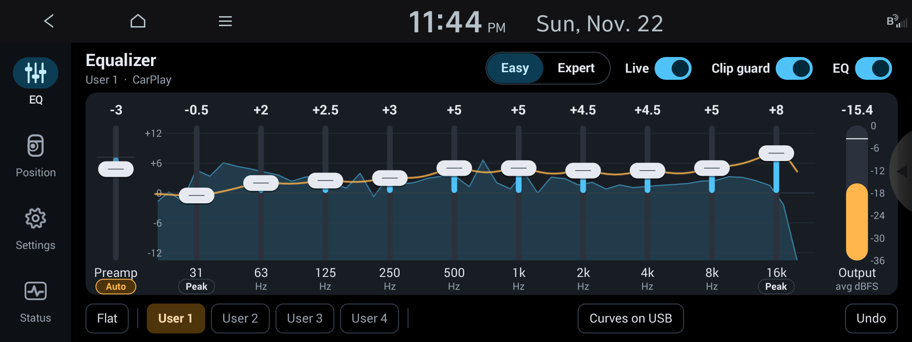
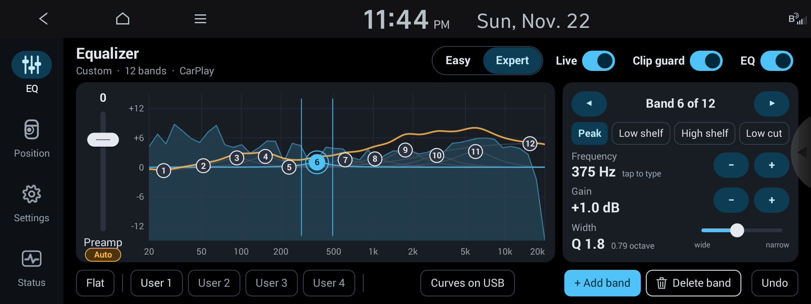
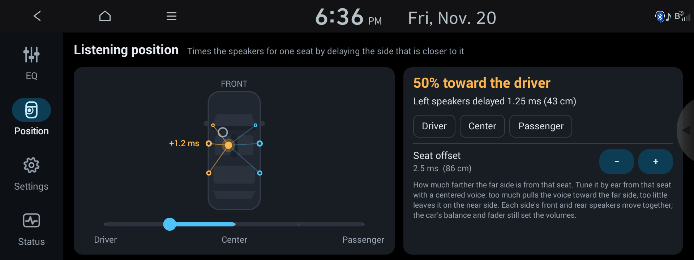
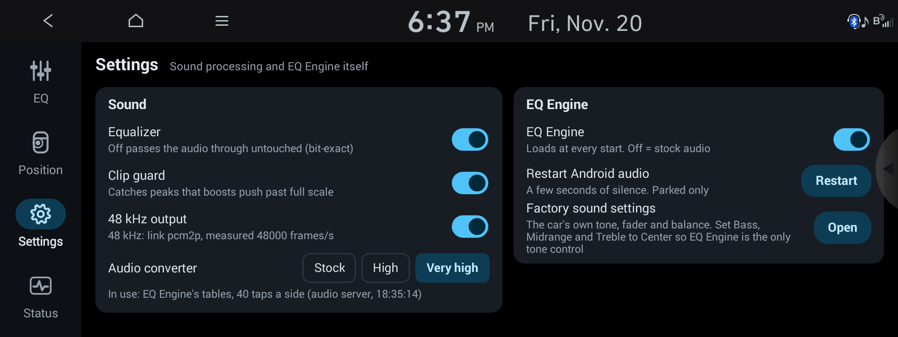
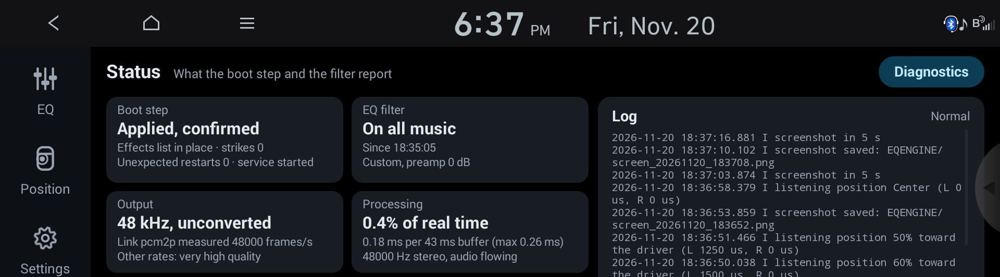
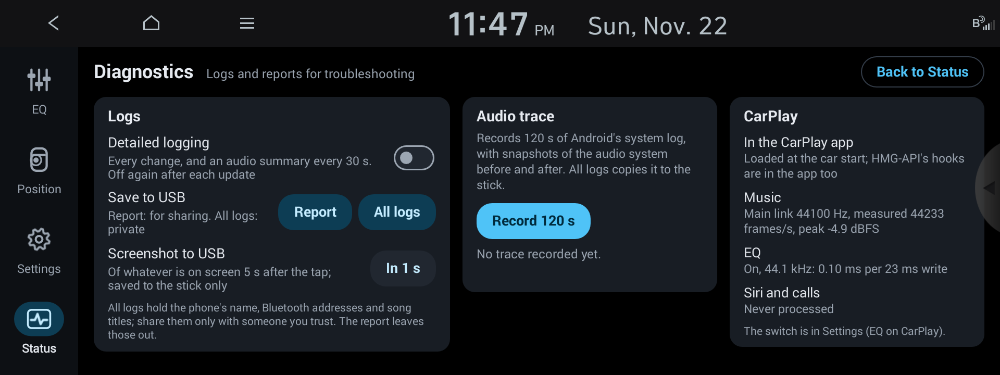

# EQ Engine

> [!WARNING]
> **Mostly written by AI. Use at your own risk.** The code, the measurements and this README were
> mostly written by an AI assistant. A person directed the work and tested it on one car, and
> owners of the other cars in [Verified vehicles](#verified-vehicles) have tested it on theirs.
> Tests on a PC and on those cars have not shown problems, but this software runs inside Android's
> audio server and the factory CarPlay app on your head unit, and you are responsible for anything
> you install on your car.

EQ Engine is a [NEMESIS](https://github.com/xwtk/hmg_nemesis) package for the Gen5W head unit
(Android 4.4), which is fitted to Hyundai, Kia and Genesis cars. It does two separate things:

1. **Sound quality, with no EQ needed.** It runs Android's main audio output at 48 kHz instead of
   the factory 44.1 kHz, so Android Auto's 48 kHz music reaches the audio hardware without being
   resampled. What still has to be resampled (Bluetooth audio, voice prompts) goes through a better
   converter. CarPlay plays at its own 44.1 kHz and is never resampled.
2. **Tone and imaging, if you want them**, on Android Auto, CarPlay and Bluetooth audio: an
   accurate 10-band EQ whose end bands can be shelves, or a parametric EQ with up to 20 bands, a
   preamp, a clip guard, a listening-position delay, and a live view of the music behind the EQ
   curve.



It is a plain NEMESIS package. It is **not** an HMG-API mod and does not need HMG-API; it works
alongside it, including HMG-API's wireless CarPlay and Android Auto package
([how](#eq-on-carplay-and-other-add-ons)).

**Current version: 0.7.6**: 0.7.4, tested on the Ioniq 5 below, plus fixes from code reviews (0.7.5
and 0.7.6). What changed: [CHANGELOG.md](CHANGELOG.md).

## Verified vehicles

| Car | Region | Audio system | Head unit software | Tested with |
|---|---|---|---|---|
| 2022 Hyundai Ioniq 5 SEL | USA | Standard (non-Bose) | 260507 | 0.7.4: Android Auto, CarPlay (wired and wireless) |
| 2024 Hyundai Ioniq 6 Preferred AWD | Canada | Bose | 260903 | 0.6.6: Android Auto |
| 2025 Hyundai Ioniq 6 Limited | USA | Bose | 260903 | 0.6.6: Android Auto |

No other car or software version has been tested, including Kia and Genesis cars with the same
head unit. Other cars may have a different amplifier, audio driver, audio settings or CarPlay
software. The package is marked for US Ioniq 5 software (`os="NEEV.USA.*"`); on other software
NEMESIS shows it as a partial match. If you try it on another car, please send a
[car report](#reporting-a-problem).

## What it does

### 48 kHz output (on by default)

Android Auto sends its music at 48,000 samples a second, and the factory software runs Android's
main output at 44,100. On a stock car every sample is resampled, and Android 4.4's converters lose
treble doing it ([measurements](#the-converter)). EQ Engine switches the output and the hardware
link behind it to 48 kHz while the car runs:
- with Android's own run-time setting: nothing in `/system` changes and the audio server is not
  restarted for it;
- accepted only if Android, the audio driver and the rate the hardware really takes (counted by
  the kernel) all say 48,000, and checked again whenever music starts. Otherwise it goes back to
  44.1 kHz.

This is for what plays through Android (Android Auto, Bluetooth audio). CarPlay does not go
through Android's audio server; it keeps its own 44.1 kHz, unconverted.

On the Ioniq 5 the link ran at 47,995-48,004 frames a second, at the right pitch, with no
clicks. [How the switch works](#the-48-khz-switch).

### The EQ

Two modes, switched at the top of the EQ page. Each keeps its own EQ; switching never changes the
other one.

- **Easy: 10 bands**, 31 Hz to 16 kHz, ±12 dB in 0.5 dB steps. The sliders are accurate (see
  [How the EQ works](#how-the-eq-works)), and the orange line is the filter's real response.
  - **Peak or shelf at the ends:** tap Peak/Shelf under the 31 Hz or 16 kHz slider. A peak lifts or
    cuts the octave around its band. A shelf also lifts or cuts everything below 31 Hz, or above
    16 kHz, and the slider still sets the level at 31 Hz or 16 kHz.
- **Expert: a parametric EQ with up to 20 bands**, for curves the 10 sliders cannot follow (a
  measured correction, say). Each band is a peak (0.1 to 4 octaves wide), a low or high shelf at
  any frequency, or a low cut (12 dB an octave). Each band is a dot on the graph, numbered by
  frequency: drag it sideways for its frequency and up or down for its gain, or use the card
  beside the graph (frequency can be typed). The first switch to Expert offers to start from your
  Easy EQ (the same sound, as 10 bands) or flat.
  - Each dot shows its own band's gain; the orange line is all the bands added together, which is
    what you hear. Bands may overlap, and where they do their boosts and cuts add up, so several
    wide boosts side by side make a much bigger total than any one dot. The graph's scale grows
    (±15, 27, 39 or 51 dB) so the whole line always fits.
- **Preamp and Auto:** Auto, under the preamp slider, sets the preamp to the largest boost the EQ
  makes anywhere from 0 Hz to half the sample rate. It turns amber when the preamp leaves more
  than 3 dB of boost to the clip guard.
- **User 1-4** (hold one to save), shared by both modes: a slot saved in Expert switches the page
  to Expert. **Curves on USB** saves the four to a stick, or loads them from it. **Flat** clears
  the EQ. There are no built-in genre presets.
- **Undo** steps back through up to 30 changes (until Android closes the app's screen).
- **Clip guard:** a look-ahead limiter that acts only on samples a boost would push past full
  scale. Its switch is on the EQ page and in Settings.
- **Live view:** the Live switch shows how loud each part of the range is, behind the curve, in
  time with what you hear. It is off by default and off again whenever you leave the app.
- **Output meter** that follows the music in time with what you hear.
- **EQ off is bit-exact:** the audio comes out unchanged, 1.3-1.4 ms later (the clip guard's
  look-ahead).



### EQ on CarPlay (on by default)

CarPlay's music, wired or wireless, gets the same EQ (Easy or Expert), preamp, clip guard and
listening position as Android Auto, with the same filter code, at CarPlay's own 44.1 kHz and with
nothing converted. The meter, the live view and the Status page show CarPlay's music while it
plays. Siri and calls are never processed. Added delay: 1.4 ms (the clip guard's look-ahead), plus
the seat delay if you set one.

Settings > EQ on CarPlay turns it off (CarPlay is flat at once) or on again (from the next car
start, or at once when it was on at this car start). If it cannot load, or the CarPlay app keeps restarting with it, it turns itself off and the
app says so the next time you open it. [How it works](#how-eq-on-carplay-works).

### Listening position

The side nearer the chosen seat is delayed, so both sides arrive there together (1.7 ms by
default; a seat offset adjusts it). Volumes stay with the car's balance and fader.



### Settings, Status and Diagnostics

- **Settings:** the EQ, clip guard and 48 kHz output switches, the [converter](#the-converter)
  (Stock, High or Very high), EQ Engine on/off, EQ on CarPlay, Restart Android audio, and a
  shortcut to the car's own tone, fader and balance page.
- **Status:** the boot step, the filter, the output rate, processing time, levels and the log,
  with CarPlay's figures while CarPlay plays.
- **Diagnostics** (from Status): detailed logging, Save to USB (a car report for sharing, or all
  logs), Screenshot to USB (taken 5 s after the tap and written straight to the stick), a 120 s
  audio trace, and what EQ on CarPlay is doing.







### What goes through it

| Source | EQ Engine's EQ | Sample rate |
|---|---|---|
| Android Auto music (wired or wireless) | yes | 48 kHz, not converted |
| CarPlay music (wired or wireless) | yes | 44.1 kHz, not converted |
| Bluetooth audio (for example an iPhone) | yes | 44.1 kHz, converted up to 48 kHz (Very high) |
| Android Auto's directions voice, the car's navigation prompts | no (Android's second output) | voice converted with the converter choice |
| Siri, phone calls (hands-free, CarPlay calls) | no | not touched |
| FM and SiriusXM radio | no (most likely not through Android) | not touched |

The car's own Bass, Midrange, Treble, fader and balance still work after EQ Engine. To have
EQ Engine as the only tone control, set Bass, Midrange and Treble to Center (Settings > Factory
sound settings opens that page).

## How the EQ works

**Accurate sliders (Easy).** A plain graphic EQ puts one filter on each slider, and neighbouring
bands overlap, so raising several sliders overshoots: with all ten at +6 dB a plain octave EQ is
off by up to 2.8 dB at the band centres. EQ Engine solves for the filter gains that make the
response at each band's centre match its slider (an interaction matrix, then three refinement
passes). For random settings within ±12 dB the centres are within 0.04 dB (PC tests). Sliders far
apart on neighbouring bands (25 dB or more) cannot all be matched; the curve then shows what you
get.

**Expert bands are what they say.** In Expert mode there is no solver: each band is its own
filter with the frequency, gain and width you set, and the bands add up, as on any parametric EQ.
The dots show each band's own setting; the orange line shows the sum.

**Bands one octave wide, all the way up.** The common filter formula makes bands narrower near
the top of the range, so the 8 kHz and 16 kHz bands were narrower than the rest and left a dip of
about 2 dB around 11-12 kHz when both were raised. The width is corrected (Expert's peaks too),
and Easy's shelves turn over at 50 Hz and 11.3 kHz.

All ten Easy sliders at +4 dB, at 48 kHz (calculated with the filter's own code):

| | 15 Hz | 20 Hz | 12.5 kHz | 18 kHz | 20 kHz |
|---|---|---|---|---|---|
| Earlier bands | 0.7 dB | 1.5 dB | 2.1 dB | 2.1 dB | 0.6 dB |
| Peaks now | 0.7 dB | 1.5 dB | 3.7 dB | 3.4 dB | 2.1 dB |
| Shelves | 4.1 dB | 4.1 dB | 3.6 dB | 4.0 dB | 4.0 dB |

**Clean processing.**
- Double-precision arithmetic.
- Your boosts are handled in three stages: the preamp makes room, the clip guard catches what
  still goes over full scale, and TPDF dither is added only to samples that were changed.
- Changes are click-free: filter settings glide over 1024 samples, and EQ on/off crossfades.
- EQ off switches to a bit-exact path.
- Clipping already in the music cannot be undone: those samples arrive flat-topped, and Status
  counts them as "Arrived clipped".

**Light on the head unit** (measured on the Ioniq 5, as a share of one of its four cores):
- 0.4-0.5% with a flat EQ.
- Each band in use costs about 35 ns per stereo sample, the same in Android's audio server and in
  the CarPlay app: 20 Expert bands came to about 3-4% with 0.7.3. 0.7.5 runs each band over a block
  of samples, with 8-12% fewer instructions (counted in an ARM emulator) and the same output bit
  for bit.
- The live view, a 4096-point FFT of the output in 48 bands about 22 times a second, adds about
  1.5% while the EQ page shows it. It is shown when that audio reaches the speakers, about 0.15 s
  after the filter sees it.

## How EQ on CarPlay works

CarPlay's music does not go through Android's audio server. The factory CarPlay app receives it
from the phone and writes it to the speaker link itself, with TinyALSA, at 44.1 kHz. So no Android
audio effect can reach it; EQ Engine has to run inside that app.

- **At each car start**, before the CarPlay app starts, EQ Engine lays a small library of its own
  over the app's JNI library, `/system/lib/libCarPlayAndroid.so`, with an in-memory bind mount
  (nothing on the car is written). Android then starts the app from the zygote as it always does.
- When the app loads its JNI library, EQ Engine's library loads an **unchanged copy of the car's
  own file** (made by EQ Engine and checked by md5) and hands it the app's call, so the app works
  exactly as before. It then points four entries of the CarPlay audio library's import table
  (`pcm_open`, `pcm_close`, `pcm_write`, `pcm_read`, found from its dynamic symbol table) at its
  own functions. No code is changed.
- Each of those calls is handed on to the car's TinyALSA. The stream it treats as **music** is
  the one CarPlay opens on the main speaker link at 44.1 or 48 kHz, 16-bit stereo; that stream is
  first run through EQ Engine's filter, into a buffer of its own. CarPlay's music always comes that
  way. EQ Engine cannot see what a stream is for, so another sound CarPlay played there in that
  format while no music played would get the EQ too; a second stream while music plays is left
  alone. Siri and calls use other rates and are handed on untouched, and the music goes dry while
  the microphone is open.
- The app's settings reach it through a small file it reads ten times a second, so changes are
  heard within a fraction of a second. Its levels and live view come back the same way.
- Before it is used, at the install and again after a factory software update, EQ Engine checks it
  in a separate process: that it finds TinyALSA, and that the car's file is the library it expects.
- EQ Engine **never restarts the CarPlay app**: turning it on or off takes effect at the next car
  start. Restarting that app while a phone is connected loses the session (seen on the test car
  with test builds), so it is never done.
- If the CarPlay app restarts twice within two minutes with it, or the library cannot load, EQ
  Engine takes it off (from the CarPlay app's next start), turns the switch off and tells you.

### EQ on CarPlay and other add-ons

Add-ons such as HMG-API hook the CarPlay app when Android starts it from the zygote, and HMG-API's
wireless package patches the CarPlay libraries in memory after checking their md5 at their path.
EQ Engine keeps out of their way:
- the app is always started by Android from the zygote, never by EQ Engine, so their hooks are set
  up as usual;
- EQ Engine stands in only for `libCarPlayAndroid.so`. It never lays anything over the CarPlay
  libraries those patches check (`libCarPlayAudio.so`, `libCarPlayCore.so`, `libCarPlayUtils.so`,
  `libiap2session.so`), so their patches go in unchanged;
- it was tested with HMG-API and its wireless CarPlay and Android Auto package: wired and wireless
  CarPlay played through EQ Engine with HMG-API's hooks in the app. Diagnostics shows whether
  HMG-API's hooks are in the CarPlay app;
- if another package has laid a file of its own over `libCarPlayAndroid.so`, EQ on CarPlay stays
  off (and says so) rather than covering it, and turning EQ Engine off, uninstalling it or the
  rescue stick never take another package's mount away: EQ Engine unmounts only its own files
  (checked by md5).

## The 48 kHz switch

- The factory driver ignores the rate asked for when an output opens, but follows Android's
  run-time `sampling_rate` setting while its stream is active.
- **While nothing plays** (at a car start or after an audio restart), a small helper plays a few
  seconds of silence so the link runs. It asks for no audio focus, so nothing is paused or
  ducked. EQ Engine switches during it, and the music then starts at 48 kHz with no gap.
- **While music plays**, it switches at once, with one short gap.
- **Android 4.4 can leave audio tracks on a freed buffer** at a rate change, which can silence
  them. For every change EQ Engine holds each audio session of the main output with a disabled
  copy of its filter, so Android moves its tracks along, then checks every track's buffer.
  Without the hold, no change is made.
- **Fallbacks:**
  - a switch the link does not follow is put back within about 3 s, with the tracks held;
  - anything that disagrees goes back to 44.1 kHz;
  - an audio server crash within 20 s of a switch turns the setting off;
  - EQ Engine never restarts the audio server for this, and does not switch while CarPlay (or any
    other app) plays to the speaker link directly.

## The converter

The converter choice (Settings) applies to what Android still converts:
- Bluetooth audio while the output is at 48 kHz;
- voice and navigation prompts;
- Android Auto's music whenever the output is at 44.1 kHz.

CarPlay is never converted.

Measured with Android 4.4's own converter code on a PC, relative to each converter's gain:

| Converter | 48 → 44.1 kHz, at 16 / 20 kHz | 44.1 → 48 kHz, at 16 / 20 kHz | 16 → 44.1 kHz, at 7 kHz |
|---|---|---|---|
| Stock (Android's default) | -3.3 / -5.3 dB (calculated) | not measured | not measured |
| High | -3.5 / -16.7 dB | -1.2 / -10.0 dB | -7.45 dB |
| **Very high** (default) | 0.0 / 0.0 dB | 0.0 / -3.2 dB | -0.28 dB |

- **Very high** is Android's very-high-quality converter with EQ Engine's own filter tables (a
  Kaiser-windowed sinc, 40 taps a side, 512 phases).
- **Noise and aliasing:** -87 dB or lower up to 20 kHz, against about -72 dB (48 to 44.1) and
  -30 dB (44.1 to 48) with High near 19-20 kHz.
- **Headroom:** the tables have -1.6 dB of gain, so the conversion cannot overflow. In the car's
  logs, High let 588-1664 clipped samples through per 30 s of music; Very high let none.
- **Cost:** about 1.6% more of one core than High, on the car.
- **Fallbacks:** if the tables fail their checksum, Android uses High, bit for bit. Each
  unexpected audio server restart steps the choice down one level and keeps it.

## Using it for 48 kHz only

Switch the EQ off (EQ page, or Settings > Equalizer). The filter then passes the audio through
bit-exact, while the 48 kHz output and the converter work as before. Leave Settings > 48 kHz
output on and the converter on Very high (both defaults), and keep Settings > EQ Engine on (it is
the master switch). Status > Output should say "48 kHz, unconverted" while Android Auto plays.
With the EQ off, CarPlay's music is passed through untouched too.

## Does it change system files?

**No. EQ Engine writes nothing to `/system` and leaves nothing behind outside its own files.**
- Two system files are covered in memory, never changed: `/system/etc/audio_effects.conf` (to add
  EQ Engine's filter to Android's list) and, while EQ on CarPlay is on,
  `/system/lib/libCarPlayAndroid.so`. Both are bind mounts that end at the next restart, or at the
  next car start when EQ Engine or EQ on CarPlay is turned off.
- The 48 kHz rate and Android's converter property last only until the head unit restarts; EQ
  Engine sets them again at every start while it is on.
- Its own files are the app and `/data/eqengine`; uninstalling removes them.
- Nothing is sent to the car's audio controller or amplifier.

## Upsides and downsides

**Upsides**
- No resampling of Android Auto's or CarPlay's music, and better conversion for what is still
  converted.
- The same EQ on Android Auto, CarPlay and Bluetooth audio: accurate, and bit-exact when it is off.
- Light on the head unit, and nothing written to `/system`.
- The car's own volume, balance, fader and tone controls keep working.

**Downsides and limits**
- **Not everything is EQ'd:** navigation prompts, Siri and calls are not.
- **EQ on CarPlay changes at a car start:** turning it on takes effect at the next car start
  (turning it off makes CarPlay flat at once). CarPlay has been tested on one car only, and other
  head unit software may ship a different CarPlay app; EQ Engine checks it before use and turns
  itself off if it does not load.
- **A short gap** when the rate changes while music already plays (after an audio restart, or
  when 48 kHz output is turned on or off).
- **About 1.6 dB louder at 48 kHz:** nothing is converted, so loud music reaches full scale.
  With EQ boosts, use the preamp or Auto.
- **44.1 kHz sources through Android are converted up**, for example Bluetooth audio: flat to
  19 kHz, down 3.2 dB at 20 kHz. With 48 kHz output off, Bluetooth plays unconverted and Android
  Auto is converted instead.
- **The amplifier side cannot be seen.** Whether the car's amplifier converts internally cannot be
  seen from Android.
- **Sometimes not loaded after a car start.** If Android's audio server reads its effects list
  before EQ Engine's boot step, EQ Engine is not loaded in it for that start; the app says so and
  offers to restart Android audio once (parked). EQ Engine never does that by itself (see the
  next point). CarPlay is not affected by this.
- **Audio restarts are tied to the rear camera.** The factory software runs the rear camera
  service in the same process as the audio server. Audio restarts (Settings > Restart Android
  audio, a converter change) happen only when you ask: do them parked, never while reversing.
- **Few cars tested, mostly written by AI.** See the warning above and
  [Verified vehicles](#verified-vehicles).

## Install

### Before you start

- **NEMESIS** must be installed on the head unit. Its
  [README](https://github.com/xwtk/hmg_nemesis#readme) covers that. EQ Engine needs nothing else.
- Get `eqengine-stick-<version>.zip` and `eqengine-rescue-stick-<version>.zip` (the same version)
  from [Releases](https://github.com/alexkozler/Gen5W-EQ-Engine/releases), or build them
  ([Building from source](#building-from-source)).
- Use one or two blank USB sticks formatted exFAT or FAT32.
- **Other audio add-ons:** EQ Engine never undoes another package's changes. If a package or mod
  has changed Android's audio effects list (`/system/etc/audio_effects.conf`, or added
  `/vendor/etc/audio_effects.conf`), EQ Engine does not start at all (Android Auto, Bluetooth
  audio and CarPlay alike), and its Status page says why. If one has laid its own file over the
  CarPlay app's library, only EQ on CarPlay stays off, and the app tells you. HMG-API and its
  wireless package are fine: the tested car runs them.
- Do this **parked**, never while reversing. The install itself restarts nothing, but you restart
  the head unit afterwards, and Android's audio server, which also runs the rear camera service,
  starts again with it.

### Steps

1. **Make the rescue stick first.** Unzip `eqengine-rescue-stick-<version>.zip` onto the top level
   of its own USB stick. Keep it in the glovebox, not plugged in. It turns EQ Engine off even when
   Android does not come up ([Rescue stick](#rescue-stick)).
2. **Make the install stick.** Unzip `eqengine-stick-<version>.zip` onto the top level of the other
   stick. `NEMESIS.data`, `README-EQENGINE.txt`, `packages/` and `EQENGINE-source/` must be at the
   root of the stick, not inside a folder.
3. With the car on and Android running, plug the install stick into the head unit's USB port.
4. Confirm the install when NEMESIS asks. Wait for "Operation completed successfully".
5. Remove the stick and **restart the head unit**: turn the car off and on again (or use the head
   unit's reset pinhole). Android's audio server loads EQ Engine's filter when it starts, and EQ on
   CarPlay is laid over the CarPlay app before that app starts.
6. Open EQ Engine from NEMESIS Manager > My Packages > EQ Engine > Launch. Play some music. On
   the Status page, the Output tile should show "48 kHz, unconverted" within about 10 s with
   Android Auto, or "CarPlay, 44.1 kHz" with CarPlay.

> [!IMPORTANT]
> **Restart the head unit after installing or updating.** Until then Android's audio has not
> loaded EQ Engine (or still has the old version), and EQ on CarPlay is not in the CarPlay app.
> Right after an install the app says so too ("Restart the car").

If NEMESIS Manager shows "Warning: Activity not started, its current task has been brought to the
front", EQ Engine was already running: that is the output of Android's `am start` command, and EQ
Engine opens normally.

The install also writes a diagnostic report and a 40-second system log to an `EQENGINE/` folder
on the install stick. That log can contain personal data ([Reporting a problem](#reporting-a-problem)).

## Updating

Install the new version the same way, over the old one. NEMESIS asks "Updating EQ Engine requires
reinstalling": answer Yes, wait for "Operation completed successfully", then **restart the head
unit** (turn the car off and on again).

- Your EQ settings and User presets are kept. Detailed logging is switched off by every update.
  An EQ loaded from one of 0.6.6's built-in presets stays as it is (shown as Custom).
- Until the restart, Android's audio server still has the old filter loaded. The EQ keeps working;
  features that need the new filter (from 0.6.6: Expert mode) say so and work after the restart.
  EQ on CarPlay starts at that restart too.
- An update must be signed with the same key as the installed app. A build signed with another key
  will not install over it; uninstall first.

After a **head unit software update**, EQ Engine checks Android's effects list at every start. If
the update changed that file, EQ Engine does not apply itself, the audio stays stock, and the
Status page says why. If the update changed the factory CarPlay app's library, EQ on CarPlay checks
the new one before using it.

## Turning it off and uninstalling

- **Off, but still installed:** Settings > EQ Engine off. Audio is completely stock from the next
  start. Turn it back on in the same place.
- **CarPlay only:** Settings > EQ on CarPlay off. CarPlay is flat at once and completely stock from
  the next car start.
- **Uninstall:** NEMESIS Manager > My Packages > EQ Engine > Uninstall, then restart the head
  unit. The uninstall step turns the boot step and the 48 kHz output off, removes the in-memory
  overlays, and sets Android's converter back to its default. NEMESIS then removes the app and
  `/data/eqengine`, including your settings and presets. Changes made on the car's own sound page
  are car settings: change them back on that page.

### Rescue stick

Use it only if something is wrong and you cannot reach the EQ Engine app or NEMESIS Manager.

- **Android running:** plug the stick in and answer Yes.
- **Android not coming up:** plug it in. NEMESIS runs it without asking, because the stick holds a
  `NEMESIS.emergency` file.

Then restart the head unit. The rescue stick turns EQ Engine off, removes its in-memory changes
(including EQ on CarPlay), resets the converter, and writes a report to `EQENGINE-RESCUE/` on the
stick. EQ Engine stays off until you turn it back on in the app, or uninstall it.

## Safety and failsafes

- **Firmware check:** the overlay is applied only if Android's effects list is byte for byte the
  one the package was built for.
- **Loaded check:** at every start the boot step checks that the audio server has EQ Engine's
  filter loaded, and says so if it does not.
- **Two-strike rule:** two starts in a row that are never confirmed good turn EQ Engine off.
- **Crash watch:** unexpected audio server restarts, twice within 60 s or three times in one start,
  turn EQ Engine off. A restart of Android's whole framework (which restarts the audio server with
  it) is told apart and logged.
- **CarPlay guard:** EQ on CarPlay is checked before use, never restarts the CarPlay app, and turns
  itself off (with a message in the app) if it cannot load or the app restarts twice within two
  minutes with it.
- **Audio restarts** happen only when you ask, one at a time and at least 10 s apart, each followed
  by a check that Android Auto's music plays again.
- **Ways back:** Settings > EQ Engine off, Settings > EQ on CarPlay off, uninstall, the rescue
  stick.

## Reporting a problem

Status > Diagnostics > Save to USB has two buttons.

- **Report** makes the car report: one text file in the `EQENGINE` folder on the stick. Play some
  music first; it records 30 s of the audio system's log and measures the hardware link.
  - It holds: the head unit's model and software, a list of checks, the sound hardware and its
    rates, which apps play at what rate, what EQ on CarPlay is doing, and EQ Engine's own logs.
  - Lines that could carry Bluetooth names or addresses, song details, a location, serial numbers
    or a VIN are left out, and the car maker's files are not copied (only their checksums).
  - Read it before you post it anywhere public, for example in a GitHub issue.
- **All logs** saves everything for debugging, including the full system log. It contains your
  phone's name, Bluetooth addresses, song titles and possibly navigation details: share it only
  privately, and only when asked. If EQ on CarPlay turned itself off, All logs holds why.

## Building from source

The build runs on Linux x86_64, on Windows with WSL, or in Docker. It was built and tested on Ubuntu
24.04 with OpenJDK 21.

**With Docker** (Windows or macOS): `tools/build-env/Dockerfile` has everything except the NDK.
Keep the NDK in a Docker volume:

```sh
docker build -t eqengine-build tools/build-env
docker volume create eqengine-ndk
docker run --rm -v eqengine-ndk:/opt/ndk eqengine-build sh -c 'cd /opt/ndk && curl -sSLO https://dl.google.com/android/repository/android-ndk-r25c-linux.zip && echo "53af80a1cce9144025b81c78c8cd556bff42bd0e  android-ndk-r25c-linux.zip" | sha1sum -c - && unzip -q android-ndk-r25c-linux.zip && rm android-ndk-r25c-linux.zip'
docker run --rm -v "$PWD:/src" -v eqengine-ndk:/opt/ndk eqengine-build sh build.sh
```

The checksum is Google's published SHA-1 for that file. Run the tests below the same way, with
`bash -c '...'` after `eqengine-build`.

**What it needs:**
- The Android NDK r25c for Linux (`NDK=`, default `~/ndk/android-ndk-r25c`) and a JDK (`javac`,
  `keytool`).
- python3 with numpy, unicorn and Pillow; gcc with AddressSanitizer; zip, unzip, git, dash and
  mksh.
- `devtools/` (not in git): aapt2 8.13.2, `android-4.1.1.4.jar`, r8 8.13.25 and apksig 8.13.2.
- `car-files/` (not in git): `framework-res.apk`, `audio_effects.conf`, `audio_policy.conf` and
  `audio.primary.tcc803x.so`, copied from your own head unit. They are the car maker's files: never
  commit or publish them. The app is linked against the car's `framework-res.apk`, and the tests
  use the others.
- `keys/eqengine.keystore` (not in git): the app's signing key. `build.sh` stops if it is missing.
  `EQE_NEW_KEY=1` makes a new one, but an app signed with a new key cannot update one signed with
  another.

`EQE_TOOLS` and `EQE_CAR` can point to `devtools/` and `car-files/` elsewhere. The stick zips are
named with the version from `pkg/NEMESIS.data`; the build stops if any other file says otherwise.

```sh
sh build.sh                                   # native code, app, package and the stick zips
for s in dash bash mksh; do bash tests/boot/run.sh $s; bash tests/act/run.sh $s; done
bash vhq/host/run.sh 40 9                     # converter tables against Android's converter code
gcc -O1 -g -fsanitize=address,undefined -fno-sanitize-recover=undefined -I tests -I native \
    -o tests/host_test tests/host_test.c -lm -ldl -lpthread && ./tests/host_test   # after vhq/host
sh native/cpwtest/run.sh                      # EQ on CarPlay against stand-ins of the CarPlay libraries
python3 native/cpwtest/exports_test.py native/out/eqe_cpwatch.so \
    $NDK/toolchains/llvm/prebuilt/linux-x86_64/bin/llvm-readelf
sh native/drvtest/run.sh                      # driver watch against a stand-in driver
bash tests/lab/run.sh                         # eqe_lab: link rates, Android's settings, symbol tables
python3 native/drvtest/tramp_test.py native/out/eqe_drvwatch.so \
    $NDK/toolchains/llvm/prebuilt/linux-x86_64/bin/llvm-readelf native/drvwatch_exports.txt
python3 tests/meta/check_meta.py pkg/NEMESIS.data
```

**Shell scripts** run on the head unit's `/system/bin/sh` (mksh) with toolbox only, so they use
shell builtins rather than printf, grep, sed, awk, head or tail. The tests run them under dash,
bash and mksh, with printf missing as on the car.

## Repository layout

| Path | What |
|---|---|
| `native/eqengine.c` | the audio filter, loaded by Android's audio server (and, without its audio-effect parts, by EQ on CarPlay) |
| `native/cpwatch.c`, `native/cpeq.h` | EQ on CarPlay: the library laid over the CarPlay app's JNI library, and the files it shares with the app |
| `vhq/` | EQ Engine's converter tables: the design script, the generated tables and their tests |
| `native/eqe_lab.c` | root helper: the links' real rate, Android's run-time settings, symbol tables for the report, EQ on CarPlay's check before use |
| `native/drvwatch.c`, `native/gen_tramp.py` | a driver watch for troubleshooting (not in the app's screens since 0.7.5) |
| `native/aosp44/`, `third_party/aosp-af/` | Android 4.4.2 headers and audio code, for building and testing |
| `pkg/` | the NEMESIS package: `NEMESIS.data`, the boot step (`bin/boot.sh`), the app's root actions and the 48 kHz keeper (`bin/act.sh`), install scripts, and the effects list overlay |
| `app/` | the Android app (Java, no Gradle), and `Hold.java`, the 48 kHz switch's helper |
| `rescue/` | the rescue stick |
| `stick/README-EQENGINE.txt` | the README that goes on the install stick |
| `tests/`, `native/cpwtest/`, `native/drvtest/` | boot step, actions, filter, EQ on CarPlay, effects-list parsing and package metadata tests |
| `tools/` | the signing helper, a mockup renderer for the app's pages, and the Docker build environment |
| `images/` | screenshots for this README |

## License and credits

No license has been chosen for EQ Engine's own code yet.

Files in `third_party/aosp-af/`, `native/aosp44/`, `native/fx44.h` and `tests/conf/` come from or
follow the Android Open Source Project, under the Apache License 2.0 (see each file's header).

EQ Engine relies on [NEMESIS](https://github.com/xwtk/hmg_nemesis) by xwtk. The Gen5W community's
work, including [HMG-API](https://github.com/Open-HMG/HMG-API), was background reading for it.
